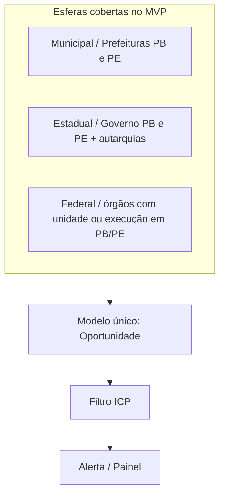
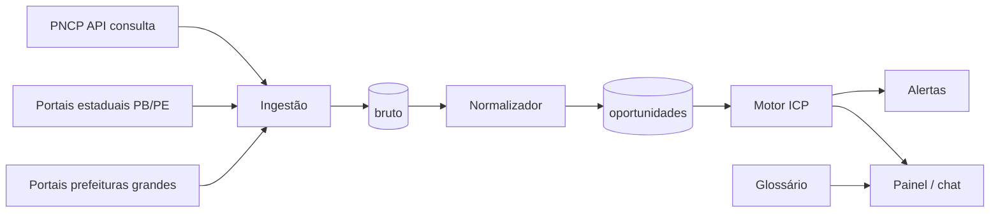

# Arquitetura — radar_concursos (PB + PE)

## Ideia em uma frase

Ingerir editais → normalizar num modelo único → filtrar pelo ICP → avisar só o que importa, em português simples.

## Esferas (tudo entra no mesmo modelo)

Cada oportunidade carrega `esfera` (`municipal` | `estadual` | `federal`), `uf`, `municipio_ibge`, `orgao_cnpj`, `orgao_nome`.

## Fluxo de dados

## Componentes

| Camada | Responsabilidade |
|---|---|
| **Ingestão PNCP** | Polling `/v1/contratacoes/publicacao` e `/proposta` com `uf=PB` e `uf=PE`, todas as modalidades necessárias |
| **Ingestão local** | Adaptadores por portal (PB/PE); nunca bloqueia o PNCP |
| **Normalizador** | Mapeia campos do PNCP/portais → `Oportunidade` |
| **ICP** | Score serve / não serve a partir do perfil |
| **Tradutor** | Resumo em linguagem simples + glossário |
| **Alertas** | Chat / e-mail; quieto se nada novo no perfil |
| **Painel** | Lista, prazo, esfera, órgão, valor, link oficial |

## Modelo `Oportunidade` (campos mínimos)

- `id_fonte`, `fonte` (`pncp` | `portal_pb` | …)
- `objeto`, `modalidade`, `modo_disputa`
- `esfera`, `uf`, `municipio_ibge`, `orgao_cnpj`, `orgao_nome`
- `valor_estimado` (se houver)
- `data_publicacao`, `data_fim_proposta`
- `url_oficial`, `hash_conteudo`
- `status` (`aberta` | `encerrada` | …)

## Por que PB + PE primeiro

Volume menor que o Brasil; o usuário está em João Pessoa; dá para validar ICP e esferas sem explodir a ingestão.

## Fora do MVP

Outros estados, geração de proposta, lances automáticos, opinião jurídica.
